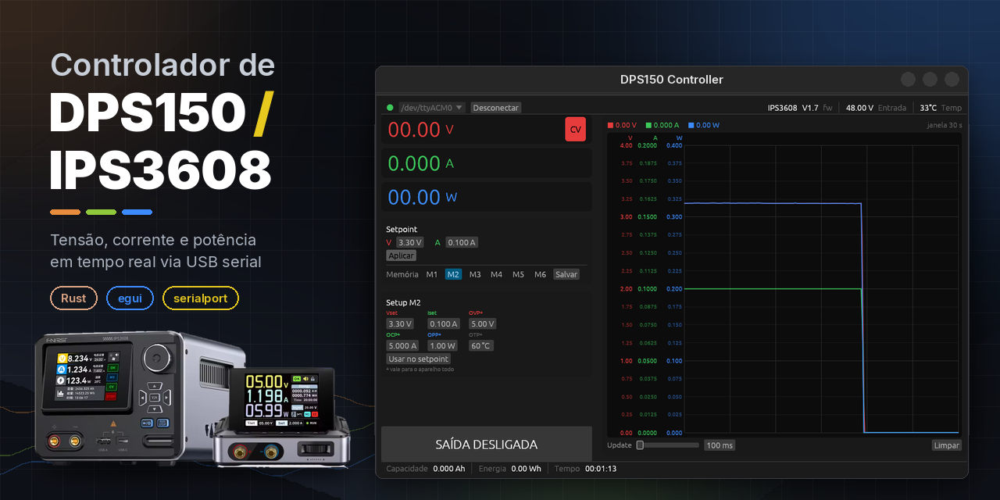

<div>
    
</div>

Comprei a fonte IPS3608, da FNIRSI, depois de ver um review dela. É uma ótima fonte, com saída de até 36 V e 8 A.
Como uso sistemas baseados em Linux, não pude usar o aplicativo que acompanha o aparelho, porque ele só roda no Windows. Isso me motivou a procurar o protocolo de comunicação usado. Descobri que é uma variante do modelo mestre/escravo, como o **Modbus**, mas simplificada, usada para controlar fontes de bancada digitais (como a série RD ou DPS da RuiDeng/Hangzhou Ruideng).

A linguagem utilizada é **Rust**. Cheguei a escrever o mesmo programa em C++23, mas o código ficou melhor e menor em Rust.

> ``Esse é um projeto experimental.``

📚 **Documentação de arquitetura:** [docs/](docs/README.md): módulos, diagramas e cada função explicada.

---

## Sumário

- [Aparelhos compatíveis](#aparelhos-compatíveis)
- [Compilação e execução](#compilação-e-execução)
- [Usando o controlador](#usando-o-controlador)
  - [Barra superior: conexão e informações do aparelho](#barra-superior-conexão-e-informações-do-aparelho)
  - [Leituras de tensão, corrente e potência](#leituras-de-tensão-corrente-e-potência)
  - [Setpoint](#setpoint)
  - [Memórias M1–M6](#memórias-m1m6)
  - [Ligar e desligar a saída](#ligar-e-desligar-a-saída)
  - [Gráfico](#gráfico)
  - [Barra inferior: capacidade, energia e tempo](#barra-inferior-capacidade-energia-e-tempo)
- [O que acontece ao conectar e desconectar](#o-que-acontece-ao-conectar-e-desconectar)
- [Protocolo](#protocolo)
- [Estrutura do código](#estrutura-do-código)
- [Fonte e licença](#fonte-e-licença)
- [Documentação de arquitetura](docs/README.md)
- [Limitações conhecidas](#limitações-conhecidas)
- [Licença](#licença)

---

## Aparelhos compatíveis

| Aparelho | Fabricante | Situação |
|---|---|---|
| IPS3608 | FNIRSI | Usado no desenvolvimento |
| DPS150 | FNIRSI | Mesmo protocolo; o nome do projeto vem dele |

As duas fontes aparecem no sistema como uma porta serial USB (no Linux, normalmente `/dev/ttyACM0`). O modelo e a versão de firmware são lidos do próprio aparelho e mostrados na barra superior.

## Compilação e execução

### Requisitos

- **Rust 1.88 ou mais novo** (edição 2024; o código usa *let chains*).
- **libudev** com os arquivos de desenvolvimento, que o crate `serialport` usa para listar as portas:
  - Fedora: `sudo dnf install systemd-devel`
  - Debian/Ubuntu: `sudo apt install libudev-dev pkg-config`
- **Permissão de acesso à porta serial.** Na maioria das distribuições, basta adicionar o usuário ao grupo `dialout` e fazer login de novo:

  ```bash
  sudo usermod -aG dialout $USER
  ```

### Executar

```bash
cargo run --release --bin controller
```

O binário `controller` ([src/controller.rs](src/controller.rs)) é a interface gráfica (egui/eframe); o arquivo só contém o `main`.

O perfil `release` é otimizado para gerar um binário pequeno (`opt-level = "s"`, LTO, `strip`, `panic = "abort"`).

## Usando o controlador

A janela tem quatro regiões: a **barra superior** (conexão e informações do aparelho), a **coluna de controle** à esquerda, o **gráfico** à direita e a **barra inferior** (acumuladores). Ao maximizar a janela, o espaço extra vai para o gráfico. Todos os textos usam a fonte **Noto Sans**, que vem dentro do programa (veja [Fonte e licença](#fonte-e-licença)).

### Barra superior: conexão e informações do aparelho

- **Indicador de status**: o ponto colorido à esquerda.

  | Cor | Estado |
  |---|---|
  | Cinza | Desconectado |
  | Amarelo | Conectando |
  | Verde | Conectado |
  | Vermelho | Erro (a mensagem aparece ao lado) |

- **Porta serial**: a lista de portas é atualizada sozinha enquanto não há conexão. Durante a conexão, a escolha fica bloqueada.
- **Conectar / Cancelar / Desconectar**: um único botão, cujo texto muda conforme o estado.
- **Informações do aparelho** (à direita, só com a fonte conectada): modelo, versão de firmware, tensão de entrada e temperatura interna.

### Leituras de tensão, corrente e potência

As três leituras grandes mostram os valores **medidos** na saída:

- **V**: tensão, com 2 casas decimais.
- **A**: corrente, com 3 casas decimais.
- **W**: potência, com 2 casas decimais.

O **modo de regulação** aparece como um selo na leitura correspondente:

- **CV** (tensão constante) na leitura de tensão;
- **CC** (corrente constante) na leitura de corrente.

### Setpoint

O card **Setpoint** define a tensão (**V**, de 0 a 36,00 V) e o limite de corrente (**A**, de 0 a 8,200 A) da saída.

- Para mudar um valor, arraste o campo com o mouse ou clique nele e digite.
- Valores editados e ainda não enviados mostram o aviso **"• não aplicado"**. Enquanto o aviso estiver aparecendo, os campos param de acompanhar o valor lido do aparelho, para não apagar o que você digitou.
- **Aplicar** (ou **Enter** no campo) envia tensão e corrente ao aparelho. O botão fica azul quando há alteração pendente.
- **Desfazer** descarta a edição e volta aos valores atuais do aparelho.

### Memórias M1–M6

A fonte tem seis grupos de memória, cada um com um par tensão/corrente. Abaixo do card Setpoint fica o **quadro de setup**, que mostra e edita seis valores, na mesma ordem do visor da fonte:

| Campo | Máximo | Unidade | Vale para |
|---|---|---|---|
| **Vset** (tensão da memória) | 36,00 | V | a memória |
| **Iset** (corrente da memória) | 8,200 | A | a memória |
| **OVP** (proteção de sobretensão) | 36,10 | V | o aparelho todo\* |
| **OCP** (proteção de sobrecorrente) | 8,200 | A | o aparelho todo\* |
| **OPP** (proteção de sobrepotência) | 295,20 | W | o aparelho todo\* |
| **OTP** (proteção de sobretemperatura) | 99 | °C | o aparelho todo\* |

\* A fonte não guarda OVP, OCP, OPP e OTP por memória: são limites do aparelho. Por isso esses rótulos têm um `*` e o quadro avisa "vale para o aparelho todo".

O texto do quadro (título, rótulos, valores e unidades) tem **16 px**, maior que o resto da interface, para ser lido sem se aproximar da tela.

- **Clique** em M1…M6 para ver os valores da memória no quadro. Nada é enviado à fonte. Sem dado, o campo mostra "—".
- **Passe o mouse** sobre M1…M6 para ver a tensão e a corrente salvas.
- Todos os campos são editáveis (arraste ou digite). Alterações ainda não salvas mostram **"• não salvo"** e não são sobrescritas pelos dados que chegam da fonte.
- Trocar de memória com alteração pendente mostra **"Descartar as alterações de Mn?"**, com **Descartar** e **Continuar editando**.
- **Desfazer** descarta a edição e volta aos valores da fonte.
- **Usar no setpoint** carrega a tensão e a corrente da memória no card Setpoint (marcando "não aplicado"). Nada é enviado até você clicar em **Aplicar**.
- **Salvar** envia os **seis valores** do quadro à fonte, gravando Vset/Iset na memória selecionada e as proteções no aparelho. Fica desabilitado sem conexão e enquanto houver erro.
- Os valores são conferidos antes de enviar. Um campo acima do máximo, vazio ou que não é número fica em **vermelho**, e a mensagem diz o motivo. Também não é aceito **Vset maior que o OVP** nem **Iset maior que o OCP**. Havendo erro, nada é enviado.
- Depois de salvar, o programa lê a fonte de volta e mostra **"verificando…"** e depois **"gravado"**. Se a fonte não devolver os valores enviados, mostra **"não confirmado"**.

> **Experimental:** a escrita de OVP, OCP, OPP e OTP ainda não foi confirmada em aparelho real. A mensagem "gravado" só aparece quando a leitura seguinte da fonte confirma.

### Ligar e desligar a saída

O botão grande no fim da coluna liga e desliga a saída da fonte:

- **SAÍDA LIGADA** (verde): a saída está ativa. Clique para desligar.
- **SAÍDA DESLIGADA** (cinza): a saída está desligada. Clique para ligar.

Sem conexão, este botão, o **Aplicar**, o **Salvar** e os campos do quadro de setup ficam desabilitados.

### Gráfico

O gráfico mostra o histórico de tensão, corrente e potência ao longo do tempo. O ponto mais recente fica à direita, e o gráfico anda para a esquerda.

- **Três escalas**: V, A e W têm faixas muito diferentes, então cada linha usa a própria escala, desenhada à esquerda na cor da linha.
  - O topo de cada escala é ajustado sozinho ao maior valor visível, com passos "redondos" (1, 2 ou 5 × 10ⁿ).
  - São 4 divisões principais, cada uma com 3 ticks intermediários com rótulos mais discretos. Se o gráfico ficar baixo demais, os rótulos intermediários somem.
  - Cada escala tem um topo mínimo (0,4 V, 0,04 A e 0,4 W). Assim, um ruído de poucos mA não ocupa o gráfico inteiro.
- **Legenda**: mostra o valor mais recente de cada grandeza e a duração da janela visível (ex.: "janela 30 s").
- **Cores personalizáveis**: clique num rótulo da legenda para abrir o seletor de cor. A nova cor vale para o rótulo, a escala, a linha e a leitura grande da grandeza. **Padrão** restaura a cor original. As cores voltam ao padrão quando o app é fechado.
- **Update**: o slider define o intervalo entre leituras, de **100 a 1000 ms** em passos de 50 ms. O mesmo intervalo vale para a consulta ao aparelho e para os pontos do gráfico.
- **Histórico**: guarda os últimos **300 pontos**. A janela visível vai de 30 s (a 100 ms) até 5 min (a 1000 ms).
- **Limpar** apaga o histórico. Conectar ou desconectar também apaga.

### Barra inferior: capacidade, energia e tempo

- **Capacidade** (Ah) e **Energia** (Wh): acumuladores informados pelo próprio aparelho.
- **Tempo**: contado pelo programa enquanto a saída está ligada. Ao desligar a saída, ele congela. Ao ligar de novo, recomeça do zero. Conectar ou desconectar também zera.

## O que acontece ao conectar e desconectar

Ao clicar em **Conectar**, uma thread separada abre a porta a 115200 baud e faz o seguinte:

1. Ativa os sinais DTR e RTS e espera **2 segundos** para a porta estabilizar.
2. Envia a sequência de inicialização, com 100 ms entre comandos:
   1. desbloqueia a sessão;
   2. confirma o baud rate de 115200;
   3. lê temperatura, modelo, versão de hardware e versão de firmware;
   4. **desliga a saída**;
   5. pede todos os dados.
3. A partir daí, envia `GET ALL` periodicamente, no intervalo escolhido em **Update**, e repassa as respostas à interface.

> **Atenção:** conectar sempre **desliga a saída** da fonte. Se ela estava alimentando um circuito, ele perde a alimentação ao conectar.

Ao clicar em **Desconectar**, o programa envia o comando de bloqueio de sessão e fecha a porta. Se a porta não abrir, ou se nenhuma porta estiver disponível, a mensagem de erro aparece na barra superior.

## Protocolo

A implementação fica em [src/logics/protocol.rs](src/logics/protocol.rs).

### Formato do pacote

```
┌────────┬─────────┬─────────┬─────────┬──────────────┬──────────┐
│ header │ comando │ type_id │ tamanho │ payload (N)  │ checksum │
│ 1 byte │ 1 byte  │ 1 byte  │ 1 byte  │ N bytes      │ 1 byte   │
└────────┴─────────┴─────────┴─────────┴──────────────┴──────────┘
```

- **header**: `0xF1` no sentido computador → fonte; `0xF0` no sentido fonte → computador.
- **checksum**: `(type_id + tamanho + soma dos bytes do payload) mod 256`.
- **Números reais**: `f32` little-endian (4 bytes).

### Comandos

| Comando | Valor | Uso |
|---|---|---|
| `GET` | `0xA1` | Lê um campo (`type_id`) ou todos (`0xFF`) |
| `BAUD` | `0xB0` | Define o baud rate (1 = 9600 … 5 = 115200) |
| `SET` | `0xB1` | Escreve um campo |
| `SESSION` | `0xC1` | `1` desbloqueia, `0` bloqueia a sessão |

### Campos (`type_id`)

| type_id | Campo | Tipo |
|---|---|---|
| 192 | Tensão de entrada | f32 |
| 193 / 194 | Vset / Iset | f32 |
| 195 | Tensão, corrente e potência de saída | 3 × f32 |
| 196 | Temperatura interna | f32 |
| 197–208 | Memórias M1–M6 (V e I alternados) | f32 |
| 209–213 | Proteções OVP, OCP, OPP, OTP, LVP | f32 |
| 214 / 215 | Brilho / volume | byte |
| 216 | Medição (metering) | byte |
| 217 / 218 | Capacidade (Ah) / energia (Wh) | f32 |
| 219 | Saída ligada (`1`) ou desligada (`0`) | byte |
| 220 | Estado de proteção (OVP, OCP, OPP, OTP, LVP, REP) | byte |
| 221 | Modo de regulação: `0` = CC, `1` = CV | byte |
| 222 / 223 / 224 | Modelo / versão de hardware / versão de firmware | texto |
| 226 / 227 | Limite superior de tensão / corrente | f32 |
| 255 | Todos os campos (veja abaixo) | bloco |

### Resposta de `GET ALL` (type_id 255)

| Offset | Campo | Offset | Campo |
|---|---|---|---|
| 0 | Tensão de entrada | 76–92 | OVP, OCP, OPP, OTP, LVP |
| 4 | Vset | 96 | Brilho (byte) |
| 8 | Iset | 97 | Volume (byte) |
| 12 | Tensão de saída | 98 | Medição (byte) |
| 16 | Corrente de saída | 99 | Capacidade (Ah) |
| 20 | Potência de saída | 103 | Energia (Wh) |
| 24 | Temperatura | 107 | Saída ligada (byte) |
| 28–72 | M1–M6 (V, I) | 108 | Estado de proteção (byte) |
| | | 109 | CC/CV (byte) |
| | | 111 / 115 | Limite superior de V / I |

Os floats nos offsets 119, 123, 127, 131 e 135 existem no payload, mas o significado deles ainda não foi identificado.

## Estrutura do código

O pacote tem uma biblioteca (`src/lib.rs`, crate `dps150`) com dois módulos, e o binário `controller` que os usa:

```
controller.rs ──▶ gui ──▶ logics
```

- **`logics/`**: regras de negócio, protocolo da fonte e sessão serial. Não depende da interface gráfica.
- **`gui/`**: a interface. Lê o estado de `logics` e repassa as ações do usuário; não tem regras nem acessa a serial.
- **`controller.rs`**: o ponto de entrada, só com o `main`.
- **`assets/`**: arquivos que vão dentro do executável. Hoje, só a fonte Noto Sans e a licença dela (`assets/fonts/`).

A descrição de cada módulo, os diagramas e a explicação de cada função estão na [documentação de arquitetura](docs/README.md); comece pela [visão geral](docs/arquitetura.md).

### Testes

As regras de `logics` e o protocolo têm testes unitários, que rodam sem interface gráfica e sem a fonte conectada:

```bash
cargo test --lib
```

## Fonte e licença

A interface usa a fonte **Noto Sans** (versão 2.015, do projeto [notofonts/latin-greek-cyrillic](https://github.com/notofonts/latin-greek-cyrillic)), distribuída sob a **SIL Open Font License 1.1**. O arquivo da fonte e o texto da licença ficam no repositório, em [`assets/fonts/`](assets/fonts/): [`NotoSans-VariableFont_wght.ttf`](assets/fonts/NotoSans-VariableFont_wght.ttf) e [`OFL.txt`](assets/fonts/OFL.txt).

A fonte é **embutida no executável** na compilação. Por isso o programa aparece igual em qualquer máquina, sem instalar fonte nenhuma, e o binário `release` pode ser copiado sozinho para outra pasta ou computador. O executável fica cerca de 0,7 MB maior por causa dela.

## Limitações conhecidas

- **Proteções**: OVP, OCP, OPP e OTP aparecem e podem ser alterados no quadro de setup (a escrita é experimental). **LVP** e o estado de proteção são lidos, mas ainda não aparecem na interface.
- **Faixas fixas**: os máximos da tabela de memórias são os da IPS3608. Em um DPS150, de faixa menor, a fonte pode recusar um valor mais alto; o programa então mostra "não confirmado".
- **Brilho, volume e medição**: são lidos, mas não aparecem na interface.
- **Cores do gráfico**: não ficam salvas entre execuções.

## Licença

Distribuído sob a licença Apache 2.0. Veja [LICENSE](LICENSE).
