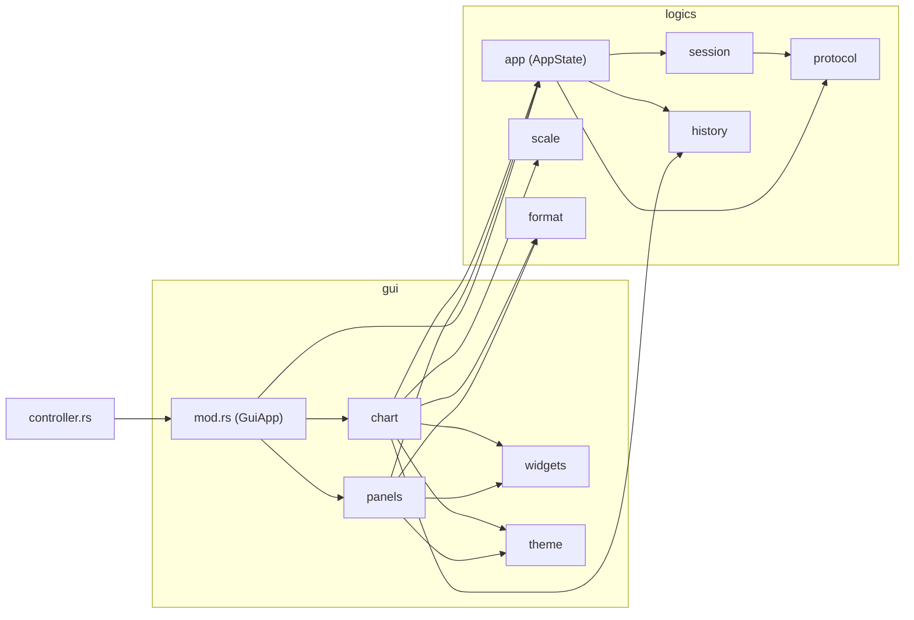
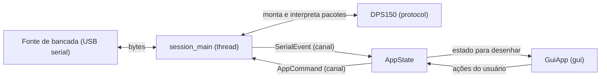
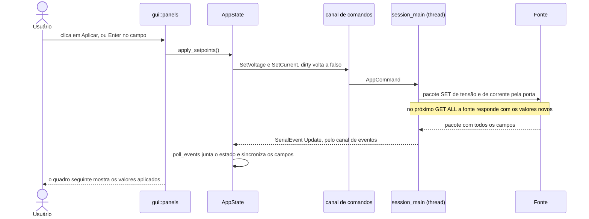
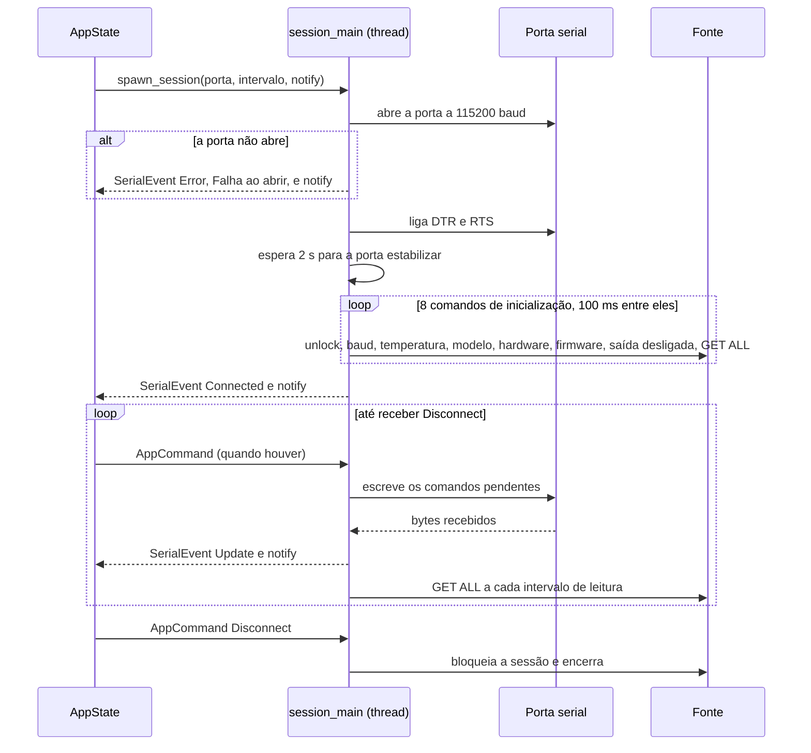
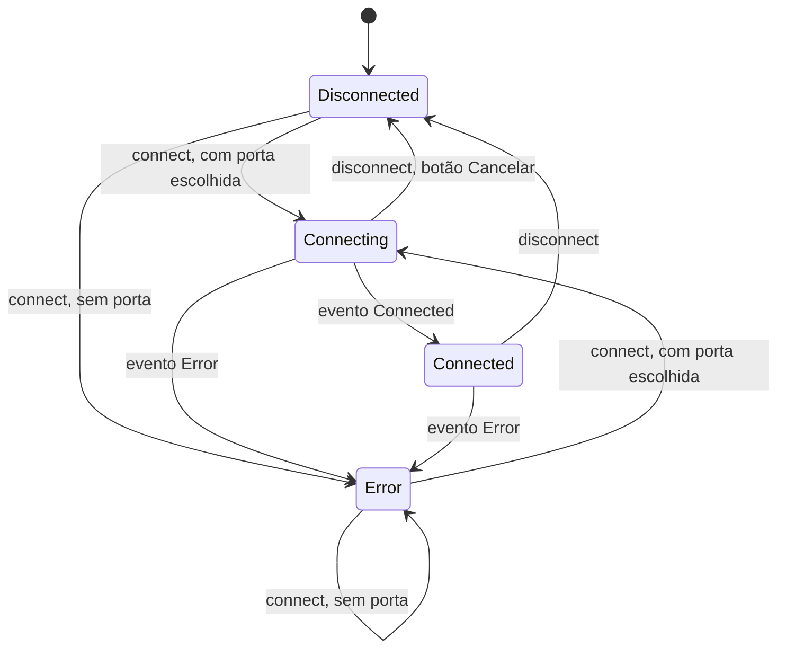
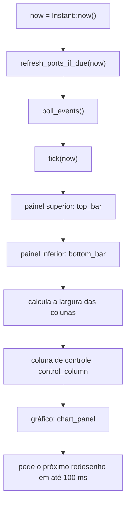

# Arquitetura

O controlador é um programa gráfico que conversa com uma fonte de bancada FNIRSI (DPS150 ou IPS3608)
por uma porta serial USB. O código está dividido em duas camadas e um ponto de entrada:

- **`logics`**: tudo o que é **regra** — o protocolo da fonte, a sessão serial, o estado da aplicação, o
  histórico do gráfico e os cálculos. Não conhece a interface gráfica.
- **`gui`**: tudo o que é **apresentação** — o layout, os painéis, o gráfico e as cores. Lê o estado de
  `logics` e repassa as ações do usuário.
- **`controller.rs`**: o ponto de entrada. Só abre a janela e entrega o controle à `gui`.

A separação existe por um motivo prático: as regras (por exemplo, "uma edição de setpoint não enviada não
pode ser apagada pelos dados que chegam da fonte") podem ser testadas sem abrir janela e sem a fonte
conectada. Os testes de `logics` rodam com `cargo test --lib`.

Sumário: [Módulos](#módulos) · [Dependências](#dependências-entre-módulos) · [Fluxo de dados](#fluxo-de-dados) ·
[Da ação do usuário até a fonte](#da-ação-do-usuário-até-a-fonte) · [Sessão serial](#ciclo-de-vida-da-sessão-serial) ·
[Estado da conexão](#estado-da-conexão) · [Ciclo por quadro](#ciclo-por-quadro) ·
[Tipos centrais](#tipos-centrais) · [Regras de projeto](#regras-de-projeto)

## Módulos

Cada linha é um arquivo de `src/`. A coluna **Não faz** marca o limite do módulo: o que *não* deve entrar
nele.

| Módulo | Papel | Não faz |
|---|---|---|
| [`controller.rs`](../src/controller.rs) | Ponto de entrada (binário `controller`). Define o tamanho da janela e chama `eframe::run_native` com `GuiApp::new()` | Regra de negócio, desenho de interface |
| [`lib.rs`](../src/lib.rs) | Raiz da biblioteca `dps150`. Declara os módulos `gui` e `logics` | Qualquer código além das declarações |
| [`logics/mod.rs`](../src/logics/mod.rs) | Declara os submódulos de `logics` e registra a regra "não depende de `gui` nem da biblioteca de interface" | Código |
| [`logics/protocol.rs`](../src/logics/protocol.rs) | **Protocolo da fonte**: monta os comandos com checksum, lê o fluxo de bytes da serial (ressincroniza se vier lixo ou pacote partido) e converte as respostas em `DPSUpdate` | Abrir a porta, criar threads, conhecer a interface |
| [`logics/session.rs`](../src/logics/session.rs) | **Sessão serial**: a thread que abre a porta, inicializa a fonte, executa comandos e repassa o que a fonte responde. Também lista as portas disponíveis | Guardar o estado da aplicação, decidir regras de setpoint, conhecer a interface (pede redesenho por um `notify` recebido) |
| [`logics/app.rs`](../src/logics/app.rs) | **Estado e regras** (`AppState`): conexão, edição do setpoint, memórias M1–M6, relógio de saída, histórico e intervalo de leitura | Desenhar, falar direto com a porta (usa canais), usar egui |
| [`logics/history.rs`](../src/logics/history.rs) | Histórico limitado das amostras (V, A, W) usado pelo gráfico | Decidir o que amostrar, conhecer a fonte |
| [`logics/scale.rs`](../src/logics/scale.rs) | Calcula o topo e as casas decimais da escala de cada grandeza do gráfico | Desenhar |
| [`logics/format.rs`](../src/logics/format.rs) | Formata durações como texto ("01:02:03", "2.5 min") | Qualquer outra formatação |
| [`gui/mod.rs`](../src/gui/mod.rs) | `GuiApp`: o ciclo de cada quadro e o layout em colunas (controle à esquerda, gráfico à direita) | Regra de negócio |
| [`gui/panels.rs`](../src/gui/panels.rs) | Barra superior (conexão), coluna de controle (leituras, setpoint, memórias, saída) e barra inferior (acumuladores) | Calcular regras: cada ação do usuário chama um método de `AppState` |
| [`gui/chart.rs`](../src/gui/chart.rs) | Painel do gráfico: legenda com seletor de cor, desenho das três séries e das escalas, slider de intervalo e botão "Limpar" | Calcular escalas (usa `logics::scale`), guardar o histórico |
| [`gui/widgets.rs`](../src/gui/widgets.rs) | Pequenos componentes reaproveitados pelos painéis (leitura grande, moldura, ponto de status…) | Ler ou alterar o estado da aplicação |
| [`gui/theme.rs`](../src/gui/theme.rs) | Constantes de cores e dimensões da interface (não tem funções) | Lógica |

### Documentação das funções

Cada módulo com funções tem um documento próprio, que explica cada função (propósito, entradas, saída,
efeitos e como funciona):
[`controller`](modulos/controller.md) ·
[`gui`](modulos/gui-mod.md) · [`gui::panels`](modulos/gui-panels.md) · [`gui::chart`](modulos/gui-chart.md) ·
[`gui::widgets`](modulos/gui-widgets.md) ·
[`logics::app`](modulos/logics-app.md) · [`logics::protocol`](modulos/logics-protocol.md) ·
[`logics::session`](modulos/logics-session.md) · [`logics::history`](modulos/logics-history.md) ·
[`logics::scale`](modulos/logics-scale.md) · [`logics::format`](modulos/logics-format.md).
As constantes de `gui::theme` estão em [`gui`](modulos/gui-mod.md#constantes-de-theme).

## Dependências entre módulos

A regra de dependência é de mão única: `controller` usa `gui`, e `gui` usa `logics`. **Nunca o contrário.**
Dentro de `logics`, `app` é quem junta as peças.

*Dependências entre os módulos. As setas vão de quem usa para quem é usado.*

## Fluxo de dados

Os dados percorrem um caminho só, em dois sentidos. A thread da sessão é a única que toca a porta
serial; a interface nunca espera por ela. As duas conversam por canais (`mpsc`):

*Fluxo de dados entre a fonte e a interface.*

- **Fonte → tela.** A thread lê bytes da porta e os entrega ao `DPS150`, que devolve atualizações
  (`DPSUpdate`). Cada atualização vira um `SerialEvent::Update` no canal de eventos. A cada quadro,
  `AppState::poll_events` esvazia o canal, junta as atualizações num único estado e a `gui` desenha
  esse estado. Uma atualização traz só parte dos campos; os que não vieram mantêm o último valor.
- **Tela → fonte.** A interface chama um método de `AppState` (por exemplo, `apply_setpoints`), que
  coloca um `AppCommand` no canal de comandos. A thread o escreve na porta no próximo ciclo dela.
- **Por que dois canais e uma thread.** Escrever e ler a serial pode demorar (a inicialização espera 2 s).
  Com a thread separada, a janela nunca congela, e a única "conversa" entre as camadas é uma fila de
  mensagens, fácil de testar.

## Da ação do usuário até a fonte

O caminho de um clique em **Aplicar**, do começo ao fim:

*Sequência de uma ação do usuário (Aplicar) até a fonte e a volta da resposta.*

Dois detalhes importam aqui:

- **Nada é enviado antes de "Aplicar".** Editar os campos só marca a edição como pendente
  (`mark_setpoint_edited`). Carregar uma memória (M1–M6) também só preenche os campos. O envio exige a
  ação explícita.
- **A edição pendente é protegida.** Enquanto ela existir, os dados que chegam da fonte não sobrescrevem o
  que o usuário digitou (`AppState::sync_edit_buffers`).

## Ciclo de vida da sessão serial

A sessão começa em `AppState::connect` e termina em `disconnect` ou num erro:

*Ciclo de vida da sessão com a fonte, da abertura da porta à desconexão.*

- **A conexão desliga a saída.** O sétimo comando da inicialização manda `OUTPUT_ENABLE = 0`. Se a fonte
  estava alimentando um circuito, ele perde a alimentação ao conectar.
- **`notify`** é uma função recebida na abertura da sessão. A thread a chama sempre que há algo novo, e a
  `gui` a usa para pedir o redesenho da tela. É assim que `logics` consegue acordar a interface sem conhecer
  a biblioteca gráfica.
- **O intervalo de leitura muda sem reconectar.** O comando `SetPollInterval` troca o intervalo do laço
  enquanto a sessão roda.

## Estado da conexão

`ConnectionState` diz em que ponto a sessão está. A interface usa esse estado para saber o que mostrar e
quais botões habilitar:

*Estados da conexão e o que provoca cada transição.*

- `Disconnected` e `Error` são os estados **ociosos** (`AppState::is_idle`): a lista de portas é
  atualizada e a escolha da porta fica liberada.
- Ao entrar em `Connecting`, sair por `disconnect` ou cair em `Error`, a telemetria é **zerada**: estado
  da fonte, relógio de saída e histórico.
- Aplicar, Salvar e o botão de saída só ficam habilitados em `Connected`.

## Ciclo por quadro

A cada quadro, `GuiApp::ui` faz o mesmo, nesta ordem:

*O que `GuiApp::ui` executa a cada quadro, em ordem.*

1. **Atualiza o estado** (três chamadas em `AppState`): atualiza a lista de portas (no máximo uma vez por
   segundo e só sem conexão), esvazia o canal de eventos e avança o relógio de saída e o histórico.
2. **Desenha**: os painéis superior e inferior, e então as duas colunas.
3. **Pede o próximo quadro** em até 100 ms, para o relógio e o gráfico andarem mesmo quando nada chega da
   fonte. O prazo é o menor entre 100 ms e o intervalo de leitura, que nunca é menor que 100 ms.

O tempo (`now`) é lido **uma vez**, no começo, e passado às regras. É por isso que elas podem ser testadas
com instantes escolhidos pelo teste, sem esperar tempo real.

## Tipos centrais

| Tipo | Onde | O que é |
|---|---|---|
| `AppState` | `logics::app` | O estado da aplicação inteira: estado da fonte, conexão, portas, setpoint em edição, memória selecionada, relógio de saída, intervalo de leitura e histórico. Todas as regras são métodos dele |
| `ConnectionState` | `logics::app` | `Disconnected`, `Connecting`, `Connected` ou `Error(mensagem)` (máquina de estados acima) |
| `SetpointEditor` | `logics::app` | Os valores de tensão e corrente em edição (`vset_input`, `cset_input`), se há alteração pendente e se algum campo está em foco |
| `OutputClock` | `logics::app` | O tempo com a saída ligada: conta enquanto ligada, congela ao desligar, zera ao ligar de novo |
| `History` e `Sample` | `logics::history` | Fila de no máximo 300 amostras (`voltage`, `current`, `power`) usada pelo gráfico |
| `AxisScale` | `logics::scale` | O topo (`max`) e as casas decimais (`decimals`) da escala de uma grandeza |
| `AppCommand` | `logics::session` | O que a interface pede à sessão: `SetVoltage`, `SetCurrent`, `EnableOutput`, `SaveProfile`, `SetPollInterval`, `Disconnect` |
| `SerialEvent` | `logics::session` | O que a sessão avisa à interface: `Update`, `Connected`, `Error` |
| `DPSUpdate` | `logics::protocol` | Uma atualização vinda da fonte. Todos os campos são opcionais (medições, setpoints, memórias, proteções, modo CC/CV, saída, acumuladores, identificação) |
| `GuiApp` | `gui` | A aplicação gráfica: um `AppState` e as três cores escolhidas para V, A e W |

## Regras de projeto

Estas regras mantêm a separação entre as camadas. Quem altera o código deve respeitá-las:

- **`logics` não usa `gui` nem a biblioteca de interface (egui/eframe).** O que a sessão precisa da
  interface (pedir redesenho) entra por parâmetro (`notify`).
- **`gui` não acessa a porta serial nem monta pacotes do protocolo.** Tudo passa por métodos de `AppState`.
- **Nenhuma E/S serial roda na thread da interface.** Só `session_main`, na sua própria thread.
- **O relógio entra por parâmetro.** As regras recebem `now: Instant` em vez de chamar `Instant::now()`,
  para os testes não dependerem do tempo real.
- **Nenhum comando é enviado sem ação explícita.** Só `apply_setpoints`, `save_profile`, `toggle_output`,
  `set_update_ms` e `disconnect` enviam algo à fonte. Selecionar, carregar uma memória ou editar um campo
  não envia nada.
- **Memória e histórico são limitados.** O histórico guarda no máximo 300 amostras e o buffer do protocolo é
  descartado quando passa de 1024 bytes sem formar pacote.
